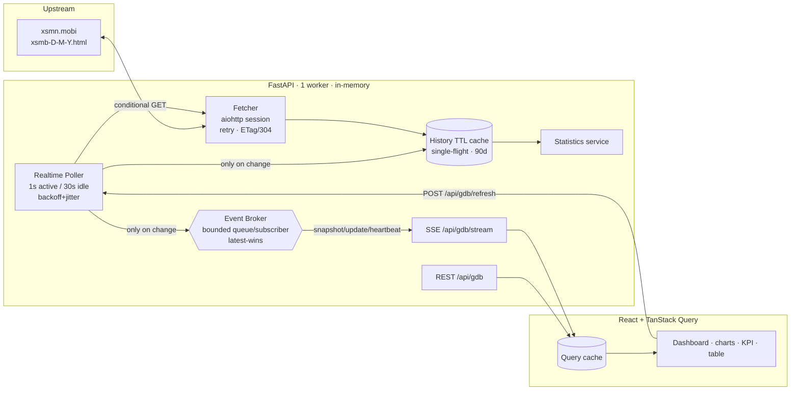

<!-- run backend -->

./venv/Scripts/python.exe -m uvicorn app.main:app --host 0.0.0.0 --port 8000 --reload


<!-- run frontend -->

cd /mnt/c/Users/Admin/Desktop/app-xo-so/frontend
npm run dev


# Thống kê GĐB XSMB — Realtime Dashboard

Ứng dụng full‑stack thu thập, **truyền theo thời gian thực (SSE)**, thống kê và trực quan hóa **2 số cuối giải đặc biệt xổ số miền Bắc (XSMB)**.

> ⚠️ **Miễn trừ:** Dữ liệu chỉ dùng cho mục đích **thống kê và tham khảo**, **không phải dự đoán kết quả**, không đảm bảo trúng thưởng và không khuyến khích đặt cược.

- **Backend:** FastAPI + aiohttp + BeautifulSoup4 + Pydantic v2 (package `app/`).
- **Frontend:** React + TypeScript (strict) + Vite + Tailwind + TanStack Query + Apache ECharts (`frontend/`).
- **Realtime:** một background poller trung tâm → Event Broker → **Server‑Sent Events** → TanStack Query cache.

---

## 1. Kiến trúc tổng thể

Một **poller upstream duy nhất** theo dõi trang kết quả của **ngày hiện tại**. Khi (và chỉ khi) 2 số cuối GĐB thay đổi, nó tăng `snapshotVersion`, dựng lại snapshot 30/60/90 ngày và **broadcast** tới mọi client SSE. Không bao giờ có một crawler riêng cho mỗi trình duyệt / mỗi kết nối.



**Luồng:**
1. Khởi động → tạo một `aiohttp.ClientSession` chung (lifespan), khởi động **1** poller, warm cache 90 ngày ở background (không chặn startup).
2. Frontend tải trang → gọi REST `GET /api/gdb` lấy snapshot khởi tạo → mở SSE `GET /api/gdb/stream?days=…`.
3. Poller parse `.v-gdb`, chuẩn hóa 2 ký tự cuối, so sánh version; chỉ khi đổi mới cập nhật cache + tính lại thống kê + broadcast.
4. Frontend nhận `snapshot`/`update` → `queryClient.setQueryData()` → KPI/chart/table cập nhật ngay, không tải lại trang.
5. Mất SSE → giữ dữ liệu cuối, hiển thị trạng thái reconnect (backoff+jitter) và bật **fallback polling** REST; phục hồi thì tắt fallback.

---

## 2. Cấu trúc thư mục

```
app/
  main.py                 # FastAPI app + lifespan (session, poller, broker)
  config.py               # Pydantic-settings, validate khi startup
  api/
    deps.py               # validate days (30/60/90), DI
    gdb_router.py         # GET /api/gdb, POST /api/gdb/refresh
    realtime_router.py    # GET /api/gdb/stream (SSE), /api/health, /api/realtime/status
  schemas/gdb.py          # Response models (camelCase, dùng chung REST + SSE)
  services/
    gdb_service.py        # fetch+parse+cache+assemble snapshot
    statistics_service.py # thống kê mô tả (thuần, deterministic)
    realtime_service.py   # poller trung tâm + backoff + manual refresh
  realtime/
    broker.py             # pub/sub in-memory, queue giới hạn, latest-wins
    state.py              # trạng thái realtime dùng chung
  cache/simple_cache.py   # TTLCache + SingleFlight (chống stampede)
  utils/
    fetcher.py            # aiohttp, retry/backoff/jitter, conditional GET, 304
    parser.py             # parse .v-gdb → 2 ký tự cuối (không bịa dữ liệu)
    date_helper.py        # range 30/60/90, weekday VN, tz, build URL
tests/                    # pytest (50 test, không chạm mạng thật)
scripts/
  smoke_realtime.py       # chứng minh 6 tính chất realtime (offline)
  smoke_multiclient.py    # nhiều SSE client với 1 poller (server đang chạy)
frontend/
  src/
    api/{client,sse}.ts   # REST client + SSE wrapper typed (reconnect)
    hooks/                # useGdbSnapshot, useGdbRealtime, useManualRefresh, useDaysParam
    components/           # StatusBadge, KpiCards, charts/*, HistoryTable, ...
    features/dashboard/   # Dashboard + DashboardHeader
    types/gdb.ts          # types mirror backend
    utils/                # format, theme (light/dark), chartTheme
```

---

## 3. Cài đặt & chạy

### Yêu cầu
- Python **3.11+** (đã test trên 3.13)
- Node **18+** (đã test trên Node 24)

### Backend

```bash
# tại thư mục gốc
python -m venv venv
source venv/Scripts/activate        # Windows Git Bash
# hoặc: source venv/bin/activate     # macOS/Linux
pip install -r requirements.txt
cp .env.example .env                 # tùy chỉnh nếu cần

# chạy dev (auto-reload)
uvicorn app.main:app --host 0.0.0.0 --port 8000 --reload

# chạy "production" in-memory — BẮT BUỘC 1 worker
uvicorn app.main:app --host 0.0.0.0 --port 8000 --workers 1
```

> Trên Windows, IANA timezone cần gói `tzdata` (đã có trong `requirements.txt`).

### Frontend

```bash
cd frontend
npm install
cp .env.example .env                 # trỏ VITE_API_BASE_URL tới backend
npm run dev                          # http://localhost:5173
```

### Test / Lint / Build

```bash
# Backend
source venv/Scripts/activate
python -m pytest -q                  # 50 test
python scripts/smoke_realtime.py     # 6 tính chất realtime (offline)

# Frontend
cd frontend
npm run lint                         # eslint, 0 warning
npm test                             # vitest, 20 test
npm run build                        # tsc + vite build
```

---

## 4. API REST

| Method | Endpoint | Mô tả |
|---|---|---|
| GET | `/api/gdb?days=30\|60\|90` | Snapshot: `data` + `statistics` + `meta`. `days` mặc định 30; giá trị khác → `422`. |
| GET | `/api/gdb/stream?days=30\|60\|90` | **SSE** stream realtime. |
| POST | `/api/gdb/refresh` | Ép kiểm tra upstream (dùng chung lock với poller). Có cooldown → `429` + `Retry-After`. |
| GET | `/api/health` | Health + observability (không crawl upstream). |
| GET | `/api/realtime/status` | Alias quan sát worker realtime. |

**Quy tắc `days`:** chỉ `30/60/90`; phạm vi N ngày gồm **hôm nay và N‑1 ngày trước** theo `Asia/Ho_Chi_Minh`; nếu hôm nay chưa có kết quả thì `meta.partial=true` và liệt kê `missingDates`. Dữ liệu `data` sắp xếp **tăng dần theo ngày**.

**Mã trạng thái:** partial nhưng có ≥1 bản ghi → `200` (kèm `meta.partial`). Upstream chết hoàn toàn & chưa từng có state → `503`. Không dùng `404` để đại diện lỗi upstream.

Response model (tóm tắt): xem `app/schemas/gdb.py`. `snapshot` và `update` của SSE **dùng chung** type với REST.

## 5. SSE events

`Content-Type: text/event-stream`, `Cache-Control: no-cache`, `Connection: keep-alive`, `X-Accel-Buffering: no`.

| Event | Khi nào | `data` |
|---|---|---|
| `snapshot` | Ngay khi client kết nối/kết nối lại | `SnapshotResponse` đầy đủ |
| `update` | Khi dữ liệu nguồn thay đổi | `SnapshotResponse` đầy đủ (version mới) |
| `heartbeat` | Mặc định mỗi 15s | `{ sentAt, snapshotVersion }` |
| `warning` | Cảnh báo (partial…) khi phù hợp | payload cảnh báo |

Mỗi event có `id:` = `snapshotVersion` và kết thúc bằng hai dòng trống. Frontend bỏ qua payload sai định dạng hoặc version cũ.

---

## 6. Biến môi trường

### Backend (`.env`)
| Biến | Mặc định | Ý nghĩa |
|---|---|---|
| `APP_ENV` / `APP_HOST` / `APP_PORT` | development / 0.0.0.0 / 8000 | Runtime |
| `LOG_LEVEL` | INFO | Log level |
| `CORS_ORIGINS` | http://localhost:5173 | Danh sách origin (phẩy). Không dùng wildcard + credentials |
| `SOURCE_BASE_URL` | https://xsmn.mobi | Nguồn |
| `SOURCE_TIMEOUT_SECONDS` / `SOURCE_CONNECT_TIMEOUT_SECONDS` | 8 / 3 | Timeout tổng / kết nối |
| `SOURCE_MAX_RETRIES` | 3 | Số lần retry |
| `SOURCE_MAX_CONCURRENCY` | 10 | Giới hạn concurrency crawl lịch sử |
| `HISTORY_CACHE_TTL_SECONDS` | 300 | TTL cache lịch sử |
| `REALTIME_ENABLED` | true | Bật/tắt poller |
| `REALTIME_TIMEZONE` | Asia/Ho_Chi_Minh | Timezone nghiệp vụ |
| `REALTIME_ACTIVE_START` / `REALTIME_ACTIVE_END` | 17:45 / 19:00 | Khung giờ poll nhanh |
| `REALTIME_ACTIVE_POLL_SECONDS` | 1.0 | Chu kỳ trong khung active (≥ MIN) |
| `REALTIME_IDLE_POLL_SECONDS` | 30.0 | Chu kỳ ngoài khung active |
| `REALTIME_HEARTBEAT_SECONDS` | 15 | Nhịp heartbeat |
| `REALTIME_MIN_POLL_SECONDS` | 1.0 | Chặn dưới chu kỳ (không cho < 1s) |
| `MANUAL_REFRESH_COOLDOWN_SECONDS` | 5 | Cooldown nút làm mới |

Cấu hình được **validate khi startup** (timezone hợp lệ, `ACTIVE_START < ACTIVE_END`, poll ≥ MIN…) — sai là fail‑fast.

### Frontend (`frontend/.env`)
| Biến | Mặc định | Ý nghĩa |
|---|---|---|
| `VITE_API_BASE_URL` | http://localhost:8000 | Base URL backend (không hardcode ở nơi khác) |
| `VITE_SSE_RECONNECT_BASE_MS` | 1000 | Backoff cơ sở khi reconnect SSE |
| `VITE_SSE_RECONNECT_MAX_MS` | 30000 | Trần backoff |
| `VITE_FALLBACK_POLL_MS` | 15000 | Chu kỳ fallback polling khi mất SSE |

---

## 7. Cache, partial & stale

- **History cache:** tối đa 90 ngày, TTL 300s; chỉ cache ngày **thành công**; **single‑flight** để nhiều cache‑miss đồng thời chỉ crawl một lần (chống stampede). Concurrency giới hạn bằng semaphore.
- **Realtime state:** tách khỏi TTL lịch sử; poller cập nhật state ngày hiện tại, chỉ tăng `snapshotVersion` khi dữ liệu nghiệp vụ đổi.
- **Conditional request:** dùng `If-None-Match`/`If-Modified-Since`; `304 Not Modified` → không parse lại.
- **Partial:** thiếu ngày → `meta.partial=true`, kèm `availableRecords`, `failedCount`, `missingDates`, `errors`. Vẫn `200` nếu có ≥1 bản ghi.
- **Stale‑while‑serve:** khi upstream lỗi, poller **giữ giá trị hôm nay gần nhất** và ghi `lastError` thay vì làm trắng dashboard.

## 8. Giới hạn

- **Phụ thuộc HTML nguồn:** parser bám selector `.v-gdb`. Nếu website đổi cấu trúc, ngày đó bị đánh dấu `no_result`/`parse_failure` (không bịa dữ liệu) — cần cập nhật `app/utils/parser.py`.
- **In‑memory:** cache + broker + subscriber nằm trong RAM. **Restart là mất** (chấp nhận được). Vì vậy **chạy 1 Uvicorn worker** — nhiều worker sẽ có nhiều poller/cache rời rạc.
- **Scale ngang:** để chạy nhiều worker/instance cần chuyển **cache, lock và pub/sub sang Redis** (Redis TTL cache, Redis lock cho single‑flight, Redis Pub/Sub cho broadcast). Route SSE giữ nguyên, chỉ đổi nguồn sự kiện.

---

## 9. Reverse proxy (Nginx) cho SSE

SSE cần **tắt buffering** để đẩy sự kiện tức thời:

```nginx
location /api/ {
    proxy_pass http://127.0.0.1:8000;
    proxy_http_version 1.1;
    proxy_set_header Connection '';
    proxy_buffering off;
    proxy_cache off;
    proxy_read_timeout 3600s;
}
```

Backend cũng gửi `X-Accel-Buffering: no` để chắc chắn Nginx không buffer stream.

---

## 10. Kết quả kiểm thử (thực đo)

- **Backend:** `pytest` → **50 passed** (date range/timezone, weekday VN, giữ `"00"/"01"/"09"`, parse `.v-gdb` & lỗi, timeout/DNS/429/404/500, retry+backoff với fake sleep, partial, cache hit/single‑flight, validation `days`, health, manual refresh cooldown, poller không phát khi không đổi / phát đúng 1 update khi đổi, nhiều subscriber cùng version, queue giới hạn, cleanup, SSE snapshot ban đầu, shutdown không leak).
- **`scripts/smoke_realtime.py`** → **PASS** cả 6 tính chất (1 poller cho nhiều client; đổi giá trị ⇒ cùng version mới; không đổi ⇒ không broadcast lặp; client chậm không chặn; backoff tăng khi lỗi; phục hồi về cadence).
- **`scripts/smoke_multiclient.py`** (server thật) → **PASS**: 5 SSE client đều nhận snapshot ban đầu từ **một** poller (`currentGdb` lấy thật từ xsmn.mobi, 90 ngày cache).
- **Frontend:** `tsc` OK · `eslint` 0 warning · `vitest` → **20 passed** · `vite build` OK (echarts tách chunk riêng).

---

## 11. Ghi chú triển khai (`docker-compose`)

Xem `docker-compose.yml` (tùy chọn) — backend 1 worker + frontend build tĩnh sau Nginx đã tắt buffering cho `/api/`.
